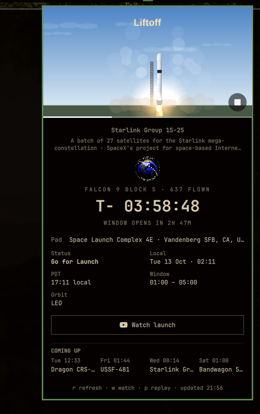

# SpaceX Launch Tracker

**SpaceX launches, at a glance.**



A simple launch tracker for [Omarchy](https://omarchy.org/) — a rocket icon in
the bar (with a live countdown only in the last hour), and a click away from
the next mission, a watch link, and a single drawn scene that comes alive as
the launch does. No API keys. It stays deliberately small next to the author's
satscope widget.

- Next-launch data: [Launch Library 2](https://ll.thespacedevs.com) (free, no
  auth) — one `upcoming` query, SpaceX only, ordered by T-0.

## Features

- **Bar** — a drawn geometric rocket; a live `T- hh:mm:ss` countdown joins it
  only in the last hour before liftoff (plus `LIVE` just after). A blinking dot
  marks a launch within ±15 minutes or already climbing. Dims when stale,
  flashes, and turns urgent past T-1h (a day out for crew/Starship/Heavy).
- **Launch scene** — the panel's full-bleed hero is a canvas scene that tracks
  the real T-0: a rocket on the pad under the real sky (day, dusk or night from
  the sun's actual position at the pad), frost and vapour as fuel-up approaches,
  a ring and per-second ticks through the last ten, ignition, the climb, the
  arc, the booster landing, and a payload-deploy recap once it is over. The pad
  plays in close-up (closest at idle, widening for the countdown ring and the
  liftoff plume); ascent hands to a follow-cam that rides the rocket along the
  arc, and landing pushes in on the booster. A play button (bottom-right, `p`,
  or `omarchy-shell maurice.spacex replay`) re-flies
  the whole sequence in ~38 seconds. See *The launch scene* below.
- **Panel** — mission blurb, patch, night-launch badge, vehicle flight heritage
  ("FALCON 9 · 637 FLOWN", counted from the API's own vehicle counters), pad,
  real status and launch probability (`83% GO` near the countdown when known),
  pad-local T-0 time, launch window with opens/closes caption, orbit, a bold
  countdown, a coming-up strip for the next launches, and a `Watch launch`
  button (reading `Watch live now` while the webcast is actually live) that
  opens the official stream in your browser. `w` also watches, `r` refreshes,
  `p` replays, `Esc` closes. Hover any truncated (`…`) text to read it in full. A real **hold** from the API freezes the countdown
  and the scene where the clock stood (caption reads `HOLD`); a real liftoff
  with a slipped clock forces ignition visuals instead of the pad. After a
  reported success or failure the countdown becomes a result card.
- **Mission personality** — routine Starlink progress stays quiet (no bar
  flash); crew, Starship and Heavy flights escalate the 1-hour and liftoff
  toasts to critical and turn the bar urgent a day out.
- **Clock source of truth** — countdowns always show the exact time to T-0,
  in the pad's local timezone (worked out from the zone and the date, because
  Quickshell's JS engine ships no `Intl`).

### The launch scene

`launch-scene.js` draws the scene; `LaunchSceneCanvas.qml` hosts it in a QML
`Canvas` and drives it. What makes it honest is that its phases hang off the
one thing this data really contains — the T-0 clock:

| Phase | Trigger (real T-0) |
|---|---|
| idle | more than 35 minutes out |
| fueling | 35 minutes → 10 seconds |
| countdown | the last ten seconds, one beat each |
| liftoff | T-0 → +10 seconds |
| ascent | +10s → +8 minutes, milestones along the arc |
| landing | the booster's descent |
| recap | payload deployed, what was tracked |

Daylight for the sky is the real sun elevation at the pad
(`Model.skyPhaseFor`), and the landing result comes from the launch's actual
status when it is known. The ascent, milestone and landing visuals are stylised
timings, not telemetry — no free API publishes position, speed or stage events.
(The library has a `setTelemetry` display hook, but there is no free live data
to feed it.) Within half an hour of T-0 the plugin polls every 4 minutes
instead of every 30, so holds, slips and liftoffs surface quickly — still well
inside the 15/hour free quota. Frames advance only while the panel is open, so
a closed panel costs nothing; hours out the scene drifts at 5fps, stepping up
to 20fps only for the flight itself. Star, plume and trail draws are batched,
so an open panel costs a few percent of one core.

### Notifications

Tiered alerts via the desktop notification daemon, one per tier, invoked only
once per launch — with `replace-id` per kind so each launch+kind collapses into
one notification slot:

- **T−24h** — one day out.
- **T−1h** — one hour out (bar turns urgent).
- **T−10m** — ten minutes out (critical).
- **Scrubs & reschedules** — when the status changes (hold / go) or the T-0
  window shifts by more than five minutes; the bar flashes.

Notification logic lives entirely in `Model.js` as a pure, unit-tested diff
(`test-model.js`, `node test-model.js`). Tier alerts only fire for launches with
a precise T-0 (net precision seconds/minutes); coarse "NET Q4 2026" launches
never produce countdowns or tier spam. First sight of a launch is always
silent, and already-passed tiers are marked fired so an install or restart in
the middle of a countdown can never re-fire an alert you already saw.

## Install

```sh
omarchy plugin add https://github.com/nautilusmare/omarchy-launchpad.git --enable
```

Or develop locally (already scaffolded at `~/.config/omarchy/plugins/maurice.spacex`):

```sh
omarchy plugin validate ~/.config/omarchy/plugins/maurice.spacex
omarchy-shell shell rescanPlugins
```

## Remove

```sh
omarchy plugin remove maurice.spacex
```

Removal deletes the plugin files. The notification state at
`~/.local/state/omarchy/maurice.spacex/state.json` is left behind and can be
deleted by hand; nothing else on the system is touched.

## Dependencies

Everything ships with Omarchy except the data, which comes from the free,
keyless [Launch Library 2](https://ll.thespacedevs.com) API (15 req/hour; the
plugin uses ~2, up to ~10 in the final half hour before a launch). At runtime
the plugin shells out to:

- `curl` — fetching the launch schedule
- `xdg-open` — opening the watch stream in your browser
- `omarchy-notification-send` — desktop alerts

## Use

- Bar shows a rocket; in the last hour before liftoff it gains a `T- hh:mm:ss`
  countdown. Left-click opens the panel, middle-click (or `r`) refreshes,
  right-click (or `w`) opens the watch link.
- `omarchy-shell maurice.spacex toggle` opens/closes the panel,
  `refresh` forces a re-fetch, `status` prints diagnostics, `watch` opens
  the stream, `replay` re-flies the launch sequence in the open panel.
- State (which launches you've been alerted about) persists to
  `~/.local/state/omarchy/maurice.spacex/state.json`.

## Configure

Widget settings via the `shell.json` layout entry:

- `refreshMinutes`: 5–180, default `30`.
- `notify24h`: `true`/`false`, default `true`.
- `notify1h`: `true`/`false`, default `true`.
- `notify10m`: `true`/`false`, default `true`.
- `notifyChanges`: scrub/reschedule alerts, `true`/`false`, default `true`.

Example:

```json
{ "id": "maurice.spacex", "refreshMinutes": 15, "notify10m": false }
```